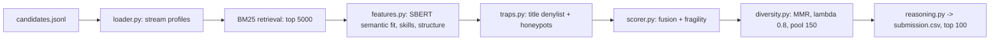

# Resume Ranker AI

An explainable candidate discovery and ranking pipeline: given a pool of 100k+ candidate profiles and one job description, it returns the top 100 candidates with a score and a fact-grounded reason for each.

**Links:** [GitHub](https://github.com/shriram-s7/Resume-Ranker-AI) · [Demo video](https://youtu.be/eIeOQ2dkHRQ)

## Overview

Built for the Redrob hackathon challenge "Intelligent Candidate Discovery & Ranking". The target role is **Senior AI Engineer (Founding Team at Redrob AI)**, whose job description and skill profile are in `ranker/constants.py`. Simple keyword matching is easy to game (keyword-stuffed skills, fake profiles), so the pipeline combines cheap sparse retrieval, semantic matching of career narratives, trust-weighted skills, hard "trap" filters and a diversity re-rank. Output is a CSV in the challenge format (`candidate_id, rank, score, reasoning`).

## Features

- **Streaming loader** for `candidates.jsonl` or `.jsonl.gz`, so the full pool never needs to sit in memory.
- **Score fusion** of semantic fit (weight 0.40), structural fit (0.30) and trust-weighted skills (0.30), then a behavioural multiplier (floor 0.30) and a notice-period penalty.
- **Anti-gaming checks:** title denylist, honeypot detection and a counterfactual fragility score.
- **Reasoning generator** that cites facts from the profile (years, title, employer, matching skills).
- **Streamlit dashboard** to run the pipeline, load a precomputed CSV, view analytics and inspect candidates.
- **Submission validator** for the challenge's CSV rules.

## How it works



## Pipeline stages

The discovery pipeline is structured into a 6-stage architecture:

1. **Stage 1: BM25 Retrieval Filter (`retrieval.py`)**
   * Performs sub-second sparse text search across the entire pool of 100k+ candidates.
   * Filters candidate list down to the top 5,000 matches before running expensive neural embeddings.
2. **Stage 2: Semantic Career Narrative Embedding (`features.py`)**
   * Uses the cached `all-MiniLM-L6-v2` Sentence-Transformer model (22MB, CPU-friendly) to embed candidate career descriptions.
   * Compares them against the Job Description via cosine similarity. 
   * Weights recent and current roles higher. Does not trust the skills keyword list to prevent keyword-stuffing hacks.
3. **Stage 3: Trust-Weighted Skill Overlap (`features.py`)**
   * Matches candidate skills against required and nice-to-have skills.
   * Trust weight is calculated as a function of skill endorsements, duration, and claimed proficiency.
   * Incorporates recruiter assessment cross-check penalties and GitHub activity scores.
4. **Stage 4: Structural & Career Stability Fit (`features.py`)**
   * Scores experience proximity to the ideal band (5–9 years).
   * Verifies location matches (prefers Indian hubs: Pune, Noida, NCR, Hyderabad, etc.).
   * Flags "title-chasers" (average tenure < 14 months).
   * Penalizes candidates with careers exclusively at service-based consulting firms.
   * Penalizes pure-academic research profiles that lack production deployment keywords.
5. **Stage 5: Honeypots and Title Denylists (`traps.py`)**
   * Disqualifies candidates with titles outside the role family (Marketing, HR, Finance, etc.).
   * Detects and blocks fabricated honeypot profiles using duration inconsistencies, salary inversions, and expert skills with 0 usage.
6. **Stage 6: MMR Diversity Re-ranking & Fragility Check (`diversity.py`, `scorer.py`, `reasoning.py`)**
   * Applies Maximal Marginal Relevance (MMR) re-ranking (Lambda=0.8) to prevent identical candidate profiles from crowding the top 100.
   * Computes a counterfactual fragility score (performance drop when the best skill is ablated) for top candidates.
   * Generates rank-consistent, fact-grounded natural language reasoning for the matches.

## Tech stack

| Layer | Technology |
|---|---|
| Language | Python (metadata records 3.11) |
| Retrieval | rank-bm25 |
| Embeddings | sentence-transformers `all-MiniLM-L6-v2` on CPU, PyTorch |
| Data | pandas, NumPy, scikit-learn |
| UI | Streamlit, Plotly |

## Project structure

```
Resume-Ranker-AI/
├── rank.py                    # Main CLI entry point
├── app.py                     # Streamlit UI dashboard
├── requirements.txt           # Dependencies
├── README.md                  # This file
├── submission_metadata.yaml   # metadata file
├── validate_submission.py     # validation utility script
└── ranker/
    ├── __init__.py
    ├── loader.py              # streaming loader and text builders
    ├── retrieval.py           # BM25 sparse filter
    ├── features.py            # SBERT semantic fit & structural logic
    ├── scorer.py              # score fusion and fragility checks
    ├── traps.py               # honeypot filter and title denylist
    ├── diversity.py           # MMR diversity reranking
    ├── reasoning.py           # rank-consistent reasoning generator
    └── constants.py           # weights, thresholds, denylists, and JD text
```

---

## Getting started

Prerequisites: Python 3.11 (as recorded in `submission_metadata.yaml`) and enough disk for PyTorch. The first run downloads the `all-MiniLM-L6-v2` model unless it is already cached. No environment variables or API keys are needed.

**Windows (PowerShell)**

```powershell
python -m venv .venv
.\.venv\Scripts\Activate.ps1
python -m pip install -r requirements.txt
```

**Linux / macOS**

```bash
python3 -m venv .venv && source .venv/bin/activate
python -m pip install -r requirements.txt
```

## Usage

The candidate dataset is supplied by the hackathon and is **not included** in this repository. Each line of `candidates.jsonl` is a JSON object with `candidate_id` (`CAND_` plus 7 digits), a `profile` block (title, years of experience, location, summary), `career_history`, `skills` and `redrob_signals`.

```bash
python rank.py --candidates ./candidates.jsonl --out ./submission.csv
python validate_submission.py submission.csv
streamlit run app.py
```

`rank.py` also accepts `--top-k-bm25` (default 5000) and `--verbose`. In the dashboard sidebar you can point to a local candidates file or load the precomputed `submission.csv` that is committed here, which avoids the several-minute CPU embedding run on 100k profiles.

## Tests

There is no unit-test suite. `validate_submission.py` checks the output CSV (exact header, 100 data rows, `CAND_xxxxxxx` ids). The pipeline itself was not re-run while writing this README because it needs the hackathon dataset and a model download.

## Status and limitations

- Complete for the hackathon submission; `submission.csv` in the repo is the produced top-100 file.
- The scoring weights and thresholds in `ranker/constants.py` were chosen by reasoning, not learned or tuned on labelled data.
- The pipeline is specific to the Senior AI Engineer job description baked into `constants.py`; another role needs new constants.
- The earlier README pointed to a mock-data generator script that is not in this repository; supply your own test profiles in the format above.
- `submission_metadata.yaml` contains placeholder contact details.

## Team

Team "Antigravity Devs" per `submission_metadata.yaml`.

## License

No license specified.
